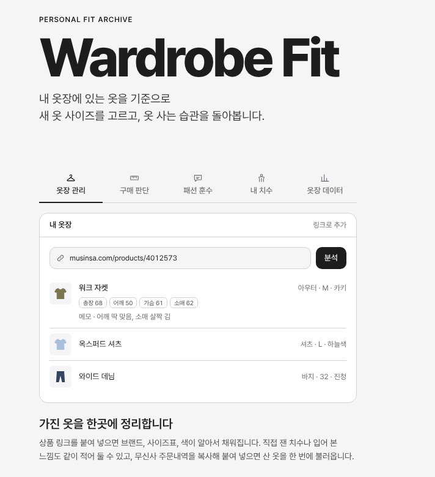
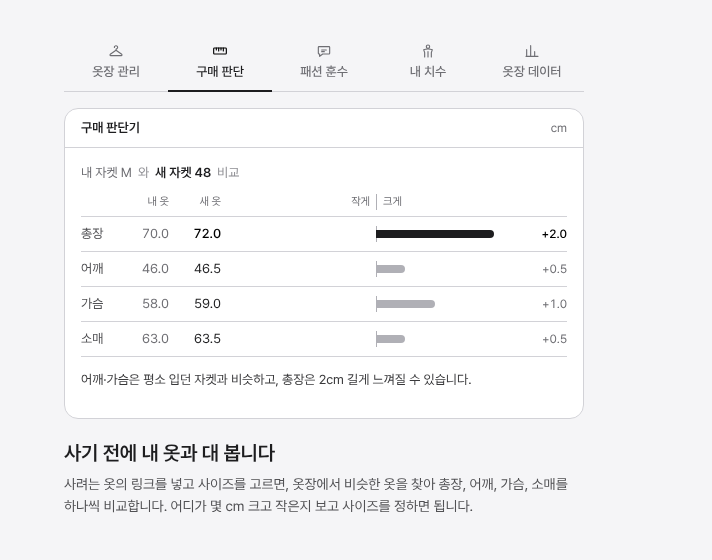
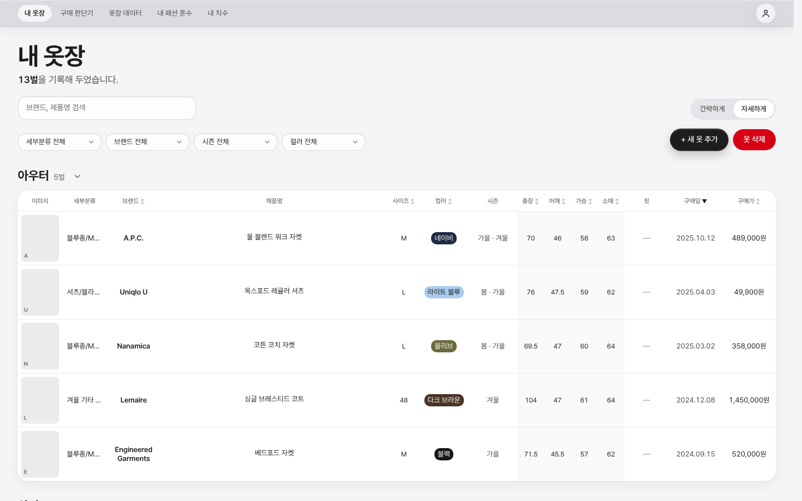
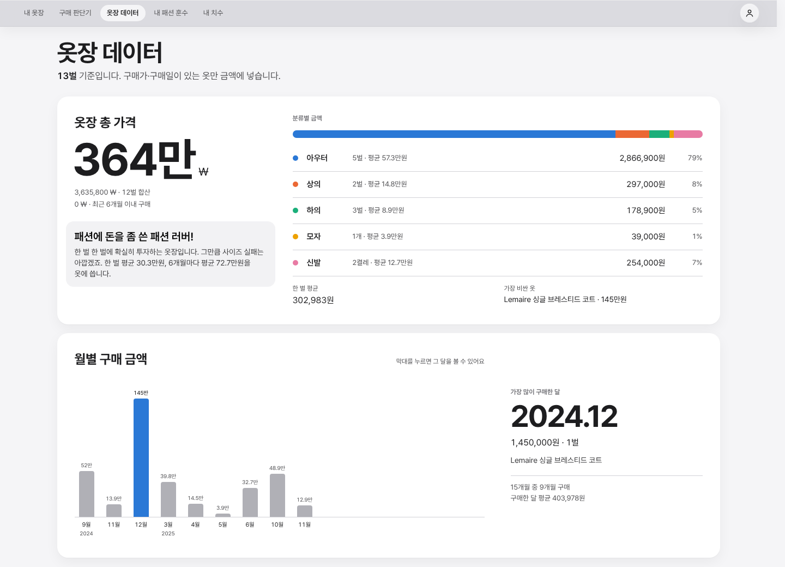
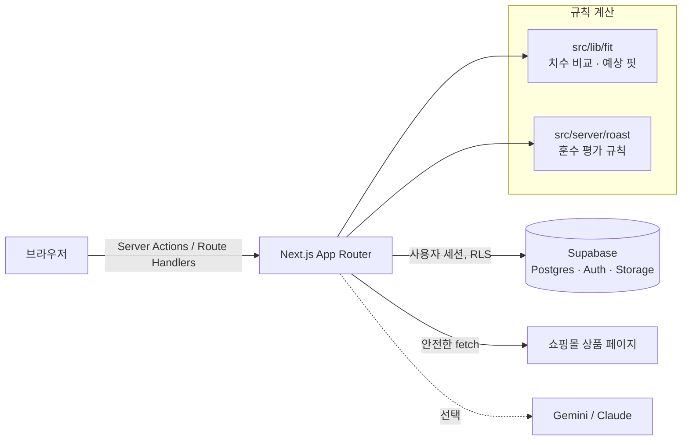

# Wardrobe Fit

입어 본 옷의 실측과 착용 후기를 기록해 두고, 새로 사려는 옷이 나한테 어떻게 맞을지 그 기록과 비교해 주는 웹 서비스입니다.

**서비스:** https://wardrobe-fit-self.vercel.app

| 문서 | 내용 |
|---|---|
| [PROJECT_SPEC.md](./PROJECT_SPEC.md) | 설계 문서: 기능, 화면 흐름, 데이터 모델, 보안, 결정 이유 |
| [docs/CODE_MAP.md](./docs/CODE_MAP.md) | 코드 지도: 영역별 파일과 주요 함수 위치 |
| [e2e/README.md](./e2e/README.md) | E2E 테스트 실행 방법 |

---

## 왜 만들었나

온라인 쇼핑몰에는 사이즈표가 늘 있습니다. 그런데 "어깨 46cm"가 나한테 어떤 느낌인지는 알 수 없습니다. 결국 옷장에서 비슷한 옷을 꺼내 줄자로 재고, 상세 페이지 숫자와 하나씩 맞춰 보게 됩니다.

이 과정을 한 번 기록해 두면 다음부터는 자동으로 비교할 수 있게 하자는 것이 출발점입니다. 키·몸무게로 체형을 추정하지 않고, **내가 실제로 입어 본 옷과 그 후기**를 기준으로 삼습니다.

## 주요 기능

| 메뉴 | 하는 일 |
|---|---|
| **내 옷장** | 옷마다 사진, 브랜드, 사이즈, 컬러, 시즌, 구매 정보, 실측, 착용 후기를 기록합니다. 대분류(아우터·상의·하의·모자·신발)별 표로 보고 검색·필터·정렬합니다. |
| **새 옷 추가** | 상품 링크를 붙여 넣으면 브랜드, 제품명, 사진, 컬러, 사이즈표를 읽어 입력 칸을 채웁니다. 무신사 주문내역을 붙여 넣어 여러 벌을 한 번에 가져올 수도 있습니다. 읽은 값은 사용자가 확인한 뒤에만 저장됩니다. |
| **구매 판단기** | 사려는 옷의 실측을 비슷한 내 옷들과 치수별로 비교합니다. 사이즈를 최대 3개까지 함께 놓고 보고, 두 상품을 나란히 비교(VS)할 수도 있습니다. |
| **내 치수** | 몸 치수를 입력하거나 잘 맞는 옷에서 거꾸로 추정합니다. 옷 종류 × 핏별 추천 실측과, 옷마다 "슬림 ~ 오버핏" 6칸 예상 핏을 보여 줍니다. |
| **옷장 데이터** | 구매 금액, 월별 구매, 브랜드·컬러 비율, 시즌 분포, 부족한 종류를 한 화면에 보여 줍니다. |
| **내 패션 훈수** | 옷장 구성을 대화형으로 평가하고 유형·점수·조언을 돌려줍니다. |

## 화면

아래 화면은 로그인 없이 예시 데이터로 띄우는 미리보기 모드에서 찍었습니다. 예시 데이터에는 옷 사진이 없어 사진 칸이 비어 있습니다.

<table>
  <tr>
    <td width="50%"></td>
    <td width="50%"></td>
  </tr>
  <tr>
    <td align="center">첫 화면</td>
    <td align="center">구매 판단 예시</td>
  </tr>
</table>


<p align="center">내 옷장: 대분류별 표에 실측·구매 정보를 모아 봅니다</p>


<p align="center">옷장 데이터: 구매 금액과 분류별·월별 구매를 한 화면에 보여 줍니다</p>

구매 판단 결과는 이런 식입니다.

```
치수   새 옷   만족했던 범위    판단
어깨   46     45 – 47 (3벌)   만족했던 옷들과 비슷함
가슴   60     59 – 61 (3벌)   만족했던 옷들과 비슷함
총장   72     69 – 70 (3벌)   길다고 적은 B 자켓(71.5)과 비슷

어깨·가슴은 만족했던 자켓들과 비슷하고, 총장은 만족 범위보다 2cm 깁니다.
```

"사세요 / 사지 마세요"가 아니라, 어느 치수가 어떻게 다른지와 그 판단이 어떤 옷·어떤 후기에서 나왔는지를 보여 주는 것이 목표입니다.

## 구조



- 화면과 서버가 같은 비교 로직(`src/lib/fit/`)을 씁니다. 입력 중 미리보기와 저장된 결과가 어긋나지 않습니다.
- 서버 코드도 사용자 세션으로 DB에 접근하므로, 권한 판단은 Postgres RLS가 맡습니다.
- AI는 계산 경로 밖에 있습니다. 호출이 실패해도 결과는 규칙만으로 나옵니다.

## 설계에서 고민한 점

**계산은 규칙으로, AI는 선택으로.** 치수 비교, 만족 범위, 신뢰도, 예상 핏은 모두 규칙이 계산합니다. 요약 문장도 규칙이 먼저 만들고, AI 키가 있을 때만 AI가 설명을 덧붙입니다. AI가 실패하거나 한도에 걸려도 결과는 그대로 나옵니다. 무료 등급 Gemini에는 후기 원문과 제품명 없이 실측·계산값만 보냅니다(`.env.example`, `src/server/ai/`).

**후기는 자유롭게 쓰고, 읽는 건 규칙이.** 착용 후기는 점수 없이 한 칸에 씁니다. "어깨는 좋은데 총장이 조금 길다" 같은 문장을 절 단위로 나눠 치수별 느낌을 뽑고, 비교할 때 근거로 씁니다(`src/lib/fit/review-signals.ts`).

**쇼핑몰 페이지는 믿지 않는 입력.** 링크 분석은 DNS를 먼저 확인해 내부망 주소를 막고(SSRF 방어), redirect마다 다시 검사하고, 응답 크기와 시간을 제한합니다(`src/server/import/fetcher.ts`). 무신사 전용, Shopify·Cafe24 플랫폼, 일반 parser를 순서대로 시도하고, 표가 아닌 글로 적힌 사이즈 정보도 읽습니다. 규칙으로 사이즈표를 못 읽은 경우에만 AI를 한 번 부릅니다.

**권한은 DB가 판단.** 모든 사용자 테이블과 사진 저장소에 Supabase RLS를 걸었습니다. 다른 사용자 데이터에 접근할 수 없다는 것은 PGlite 로컬 테스트와 실제 Supabase 테스트 두 가지로 확인합니다.

**훈수도 규칙으로.** 패션 훈수는 AI를 부르지 않습니다. 옷장의 브랜드, 가격, 색, 핏 같은 특징으로 유형과 점수를 규칙으로 계산합니다. 브랜드 판단에는 CSV로 관리하는 브랜드 3,759개 데이터를 씁니다(`data/brands/brand-master.csv`). 대화와 결과 문장은 DB에 저장되어 관리자 화면에서 고칠 수 있습니다.

**무료 등급 안에서 운영.** 사용자별 최근 24시간 한도를 둡니다. 링크 분석 100회, 무신사 주문 가져오기 500회, 구매 판단 20회(그중 AI 요약 10회)이고, 화면에 남은 횟수와 초기화까지 남은 시간을 보여 줍니다. 사진은 WebP로 줄이고 EXIF를 지웁니다.

**AI가 만든 것 같지 않은 화면.** 그라데이션, 큰 히어로 문구, "자동 입력됨" 같은 배지를 쓰지 않았습니다. 무채색에 포인트 색 하나, 얇은 선과 표 위주로 만들고 다크 모드를 지원합니다. 디자인 토큰(`src/styles/tokens.css`) 밖의 색·radius는 ESLint가 경고합니다.

## 품질 관리

PR마다 GitHub Actions(`.github/workflows/ci.yml`)가 두 작업을 돌립니다.

1. **check**: lint, 타입 검사, 단위 테스트(Vitest), 빌드, 브라우저 번들에 비밀 키가 없는지 검사
2. **e2e**: 로컬 Supabase를 띄우고 마이그레이션을 적용한 뒤 Playwright 시나리오 실행. 외부 쇼핑몰과 AI는 모의 응답을 씁니다.

단위 테스트는 parser, 데이터 정리 규칙, 치수 비교, 예상 핏, SSRF 방어, 훈수 점수 계산 등을 다룹니다. E2E는 인증, 옷장, 링크 가져오기, 구매 판단, 모자·신발, 관리자, 보안 시나리오를 다룹니다(`e2e/`).

## 기술 스택

| 영역 | 사용 기술 |
|---|---|
| 프론트엔드 | Next.js 16 (App Router), React 19, TypeScript, Tailwind CSS 4 |
| 백엔드·데이터 | Supabase (Postgres, Auth, Storage, RLS), Zod, cheerio |
| AI(선택) | Gemini Flash-Lite 또는 Claude Haiku 4.5 |
| 테스트 | Vitest, PGlite, Playwright |
| 배포·운영 | Vercel, GitHub Actions, Dependabot |

## 로컬에서 실행

Node 22 기준입니다.

```bash
npm install
cp .env.example .env.local   # 값 채우기
npm run dev                  # http://localhost:3000
```

Supabase 값(`NEXT_PUBLIC_SUPABASE_URL`, `NEXT_PUBLIC_SUPABASE_ANON_KEY`)을 비워 두면 로그인 없이 예시 데이터로 둘러보는 미리보기 모드로 뜹니다. 화면만 볼 때는 이것으로 충분합니다.

실제로 쓰려면 Supabase 프로젝트를 만들고 `supabase/migrations/`를 번호순으로 적용합니다. Authentication > URL Configuration의 Redirect URLs에 `http://localhost:3000/**`를 넣어야 인증 메일 링크가 돌아옵니다. 환경 변수는 `.env.example`에 설명과 함께 이름만 적어 두었습니다.

| 명령 | 설명 |
|---|---|
| `npm run dev` | 개발 서버 |
| `npm run build` / `npm start` | 빌드 / 실행 |
| `npm run lint` | ESLint(디자인 토큰 밖의 색·radius도 경고) |
| `npm run typecheck` | 타입 검사 |
| `npm test` | 단위 테스트 |
| `npm run test:db` | Supabase 없이 PGlite로 마이그레이션과 RLS 교차 접근 차단 확인 |
| `npm run test:e2e` | Playwright E2E(로컬 Supabase 필요, [e2e/README.md](./e2e/README.md)) |
| `npm run check:bundle` | 빌드 결과의 브라우저 번들에 비밀 키가 없는지 확인 |
| `npm run db:apply` / `npm run db:types` | 원격 Supabase에 마이그레이션 적용 / DB 타입 생성 |
| `npm run test:rls` | 실제 Supabase에서 사용자 간 접근 차단 확인 |

## 폴더 구조

```
src/
  app/               페이지와 API(/api/imports, /api/fit-checks, /api/order-imports 등)
  components/        화면 컴포넌트(옷장, 구매 판단기, 훈수, 관리자 등)
  lib/fit/           비교 대상 선정, 후기 읽기, 치수 비교, 예상 핏(화면과 서버가 같이 씀)
  server/import/     링크·주문내역 분석: 안전한 fetch, parser, 정리 규칙
  server/ai/         AI 제공자 선택과 응답 검증
  server/roast/      패션 훈수: 평가 규칙, 브랜드 데이터, 서버 액션
  styles/tokens.css  디자인 토큰
supabase/migrations/ 스키마, RLS, Storage 정책
data/brands/         브랜드 데이터 원본(CSV)
e2e/                 Playwright 시나리오
scripts/             DB 적용·검사, 번들 검사, 브랜드 데이터 생성
```

파일별 위치는 [docs/CODE_MAP.md](./docs/CODE_MAP.md), 설계와 결정 이유는 [PROJECT_SPEC.md](./PROJECT_SPEC.md)에 자세히 적어 두었습니다.

## 개발 방식

`feature/*` 브랜치에서 작업하고 PR로 `develop`에 모은 뒤, `main`으로 올려 운영에 배포합니다. Vercel은 `develop`(미리보기)과 `main`(운영)만 배포합니다.
